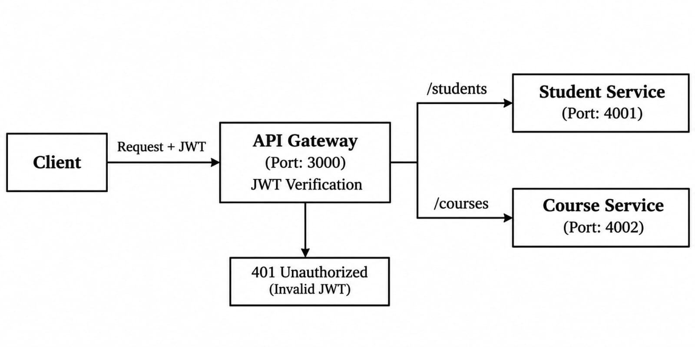

# Advantages of Microservices over Monolithic Architecture

## 1. Independent Development and Deployment
Each microservice can be developed, tested, updated, and deployed independently without affecting other services. This makes application development and maintenance easier.

## 2. Scalability and Fault Isolation
Each service can be scaled independently based on its requirements. If one service fails, the other services can continue functioning without affecting the entire application.

## Architecture Diagram

